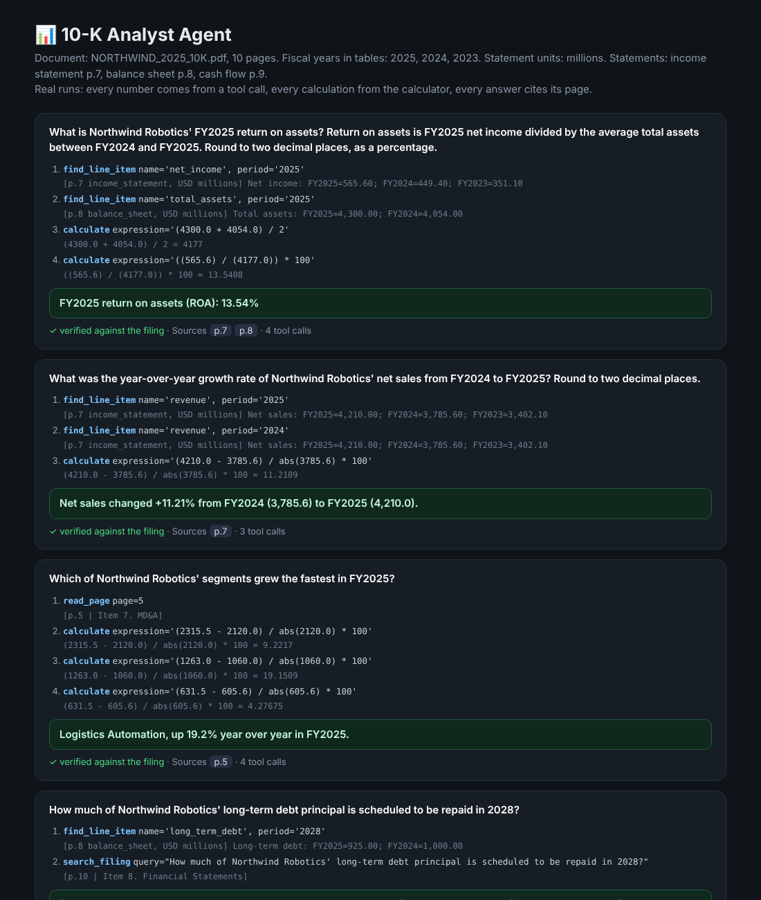
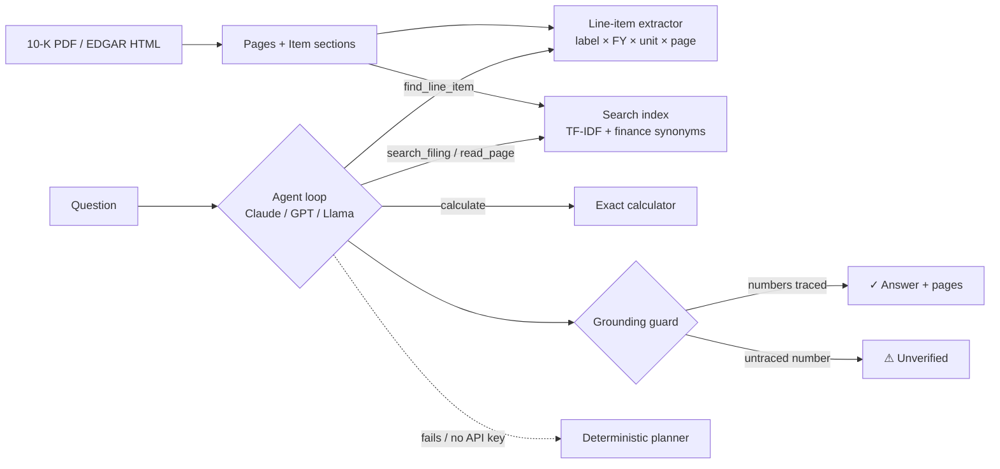

# 📊 10-K Analyst Agent: Financial Q&A over SEC Filings with Verified Math

> Ask a question about any 10-K or 10-Q. An AI agent searches the filing, reads the financial statement tables, does the arithmetic with an exact calculator, and answers with the page it came from. Any number it cannot trace back to the filing is flagged.

    



Plain RAG chatbots fail on financial filings. In the FinanceBench paper, GPT-4-Turbo with a retrieval system answered incorrectly or refused **81%** of questions ([Islam et al., 2023](https://github.com/patronus-ai/financebench)). The usual causes are tables that get chunked into nonsense, arithmetic done "in the model's head", and answers with no traceable source. This project attacks all three:

| Problem | What this agent does |
|---|---|
| Tables break in text chunking | Statement pages are parsed into structured **line items** (label × fiscal year, with units and page) that the agent queries directly |
| LLMs miscalculate | Every ratio, growth rate, average and unit conversion goes through a **safe calculator tool** (AST-whitelisted, no `eval`) |
| Hallucinated numbers | A **grounding guard** checks every number in the answer against tool outputs (allowing rounding, sign, %/ratio and unit changes) |
| No sources | Every answer carries **page citations**; citations to pages the agent never opened are dropped |

## How it works



**Agent tools:** `find_line_item(name, period)`, `search_filing(query)`, `read_page(page)`, `calculate(expression)`. The LLM picks one tool per turn as a JSON action (ReAct pattern), so Claude, OpenAI and local Ollama models all speak the same protocol, and the whole loop is unit-tested with a scripted fake model.

**Offline mode (no API key):** a deterministic planner recognises the common question shapes (reported line items, 16 named ratios such as ROA, current ratio and fixed-asset turnover, growth rates, "which segment grew fastest", text lookups, yes/no) and calls the same tools. It is the CI baseline and the LLM agent's fallback when the model errors or runs out of steps.

## Quickstart

```bash
git clone https://github.com/Afnan309/financial-analyst-agent.git
cd financial-analyst-agent
pip install -e ".[dev]"

finagent ask samples/NORTHWIND_2025_10K.pdf "What is the FY2025 return on assets? Use average total assets." --trace
finagent extract samples/NORTHWIND_2025_10K.pdf --csv line_items.csv
finagent chat samples/CASCADE_2024_10K.htm

# with Claude
pip install -e ".[claude]" && export ANTHROPIC_API_KEY=sk-ant-...
finagent ask samples/NORTHWIND_2025_10K.pdf "How did gross margin change and why?" --provider claude --trace

# fully local (filings never leave your machine)
ollama pull qwen2.5:14b
finagent ask my_10k.pdf "What was free cash flow?" --provider ollama
```

Example trace (offline mode):

```
$ finagent ask samples/NORTHWIND_2025_10K.pdf "What is the FY2025 operating margin? Round to one decimal place." --trace
FY2025 operating margin: 18.0%
Sources: p.7

Agent trace:
  1. find_line_item(name='operating_income', period='2025') -> [p.7 income_statement, USD millions] Operating income: FY2025=757.80; ...
  2. find_line_item(name='revenue', period='2025') -> [p.7 income_statement, USD millions] Net sales: FY2025=4,210.00; ...
  3. calculate(expression='((757.8) / (4210.0)) * 100') -> ((757.8) / (4210.0)) * 100 = 18
```

### Real filings from SEC EDGAR

```bash
export SEC_USER_AGENT="Your Name you@example.com"      # SEC requires a contact address
python scripts/download_data.py edgar --ticker AAPL --year 2024
finagent ask data/edgar/AAPL_2024_10K.htm "What were total net sales and how much was services?" --provider claude
```

### Web UI and API

```bash
pip install -e ".[ui,api,claude]"
streamlit run app/streamlit_app.py           # chat, agent trace, extracted statements, page viewer
uvicorn finagent.api:app --reload            # http://localhost:8000/docs
```

| Method | Path | Purpose |
|---|---|---|
| `POST` | `/documents` | Upload a filing (multipart), optional `provider`, `model` |
| `POST` | `/documents/{id}/ask` | Question → answer, value, unit, citations, full tool trace, warnings |
| `GET` | `/documents/{id}/line-items` | Every extracted statement line item |
| `GET` | `/documents/{id}/pages/{n}` | Page text and section |

Docker: `cp .env.example .env && docker compose up --build` (API on :8000, UI on :8501).

## Evaluation

### FinanceBench (real SEC filings)

[FinanceBench](https://github.com/patronus-ai/financebench) has 150 open-source questions over real 10-K/10-Q/8-K filings, with gold answers and evidence page numbers. The runner scores numeric answers automatically (1% tolerance, unit-aware), yes/no answers by polarity, and free-text answers with an optional LLM judge; it also reports the **page hit rate** (did the agent cite the gold evidence page?).

```bash
python scripts/download_data.py financebench            # clones the dataset (CC BY-NC 4.0)
python eval/run_financebench.py --data data/financebench --provider offline
python eval/run_financebench.py --data data/financebench --provider claude --judge claude
python eval/run_financebench.py --data data/financebench --provider claude --types metrics-generated
```

| Provider | Questions | Accuracy | Page hit rate |
|---|---:|---:|---:|
| offline planner | 150 | _run to fill in_ | _run to fill in_ |
| Claude | 150 | _run to fill in_ | _run to fill in_ |
| Paper baseline: GPT-4-Turbo + retrieval | 150 | ≈19% correct (81% wrong or refused) | n/a |

### Bundled sample filings (fictional companies)

| Filing | Format | Questions | Round | Accuracy | Page hit rate |
|---|---|---:|---|---:|---:|
| Northwind Robotics 10-K (dev set) | PDF, USD millions | 20 | final | 20/20 | 100% |
| Cascade Foods 10-K (**held out**) | EDGAR HTML, USD thousands, different labels | 13 | round 1 (first blind run) | 12/13 | **0%** |
| Cascade Foods 10-K (held out) | | 13 | round 2 (after fixes) | 13/13 | 100% |

Round 1 is kept on purpose (`eval/sample_results/rounds/`). It exposed a real bug: EDGAR's `<hr style="page-break-after:always"/>` split every page in two, so every citation was off by a page. The fixes were general (HTML page breaks, yes/no polarity, "$150 million to $160 million" ranges), not tuned to the answers. Both sample companies are fictional, so these numbers show that the pipeline works end to end; the FinanceBench run is the real benchmark.

## Project layout

```
src/finagent/
  ingest.py      PDF + EDGAR HTML -> pages with Item sections (page breaks, $ and ( ) cells)
  tables.py      statement pages -> line items (years, units, wrapped labels, % columns)
  finance.py     label vocabulary across companies + 16 metric formulas
  index.py       stemmed TF-IDF search, TOC pages excluded
  tools.py       find_line_item / search_filing / read_page / calculate
  calculator.py  AST-whitelisted arithmetic
  grounding.py   numeric grounding guard
  agent.py       ReAct JSON-action loop, citation filter, fallback
  planner.py     deterministic analyst (offline mode)
  llm.py         Claude, OpenAI, Ollama clients
  scoring.py     FinanceBench scoring (numeric, yes/no, LLM judge)
  api.py, cli.py
app/streamlit_app.py
eval/run_financebench.py
scripts/  download_data.py · make_sample_10k.py · make_sample_edgar_html.py · render_demo.py
tests/    33 tests: parsing, statements tie out, calculator safety, agent loop with a scripted LLM, guards, scoring, CLI, API
```

## Limitations

- Scanned PDFs need OCR first; the extractor reads text-layer PDFs and EDGAR HTML.
- Line-item extraction expects one row per line with one number per fiscal-year column; unusual layouts fall back to text search.
- The offline planner covers common question shapes; open-ended analysis ("why did margins fall?") needs an LLM provider.
- Not investment advice.

## License

MIT © Afnan Asjad. FinanceBench data is CC BY-NC 4.0 and is downloaded, not redistributed. Sample companies are fictional.
